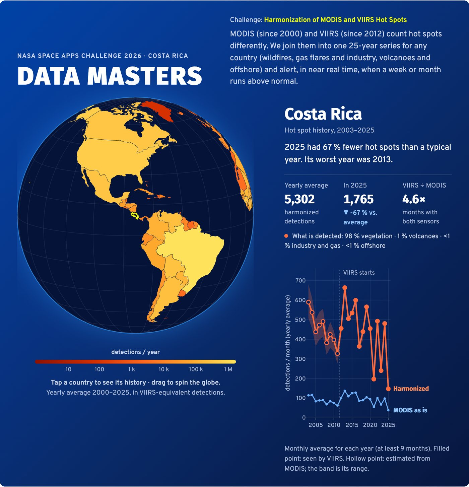
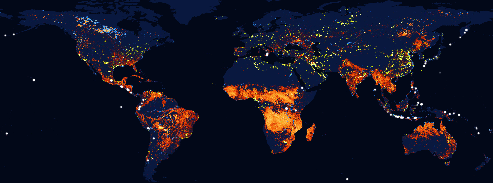
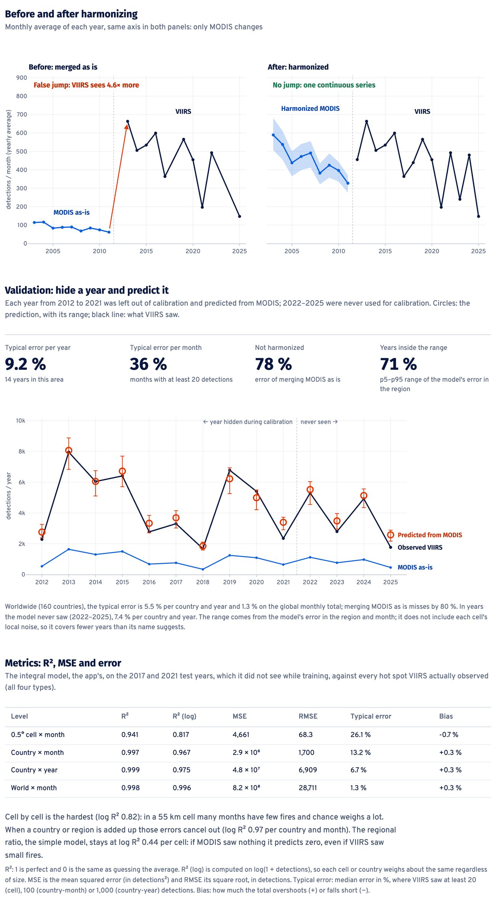

# Data Masters — Every hot spot on Earth, on one calendar since 2000

NASA Space Apps Challenge 2026 · Costa Rica · Challenge **Harmonization of MODIS and VIIRS Hot Spots**.

- **Demo:** https://data-masters.streamlit.app
- **Code:** https://github.com/KevinPhill/data-masters
- **Slides** (7): [PDF](docs/presentacion/Data_Masters.pdf) · [PowerPoint](docs/presentacion/Data_Masters.pptx)
- [Resumen en español](#resumen-en-español)

Satellites have watched the planet's fires since 2000, but the record breaks in two. MODIS (since 2000) and VIIRS (since 2012) count heat differently: VIIRS reports about 4.5 times more detections. Join them as they are and 2012 looks like a worldwide fire wave that never happened. Data Masters harmonizes both into one 25-year series, in VIIRS-equivalent detections, for **any country on Earth**, so firefighters, early-warning managers, public health teams, energy regulators and scientists can tell in seconds whether **this month is normal here**.

It is not only about forests. FIRMS sees four kinds of heat, and the app harmonizes each one with its own model: vegetation fires, industry and gas flaring, volcanoes, and heat over water (offshore).

Data: NASA FIRMS · Project for NASA Space Apps Challenge 2026 Costa Rica. Not an official NASA product.



## Why it matters worldwide


*Every VIIRS (NOAA-20) detection of 2024–2025 in NASA FIRMS, coloured by type and drawn by `scripts/imagenes_presentacion.py`: vegetation in orange, industry and gas in yellow, volcanoes in white, over water in blue.*

| Kind of heat (FIRMS type) | Detections 2024–2025 | Why it matters | Who acts on the answer |
|---|---|---|---|
| Vegetation fires (0) | 38.1 M | Smoke from landscape fires is linked to about 1.53 million deaths a year (The Lancet, 2024). | Firefighters, emergency committees, public health, land managers |
| Industry and gas (2) | 2.53 M | 151 bcm of gas flared in 2024, about 389 MtCO₂e (World Bank, Global Gas Flaring Tracker 2025). | Energy regulators, climate inventories |
| Volcanoes (1) | 52,773 | Kīlauea, Nyiragongo, Etna, Semeru: heat that must not set off a wildfire alert. | Volcano observatories, civil protection |
| Over water (3, "offshore") | 161,472 | Offshore platforms, coastal plants and fires on lake and river shores. | Environmental and maritime agencies |

- **A record that does not break.** Suomi NPP stopped delivering data on 2 November 2026 (NASA Earthdata) and MODIS is planned to end in 2027 (NASA LAADS). Without a bridge, 25 years of MODIS cannot be compared with what NOAA-20 and NOAA-21 will keep measuring.
- **The same question in every country.** Tap any country on the globe. Each month the app ranks the countries of the world running above normal and alerts on runs of abnormal weeks or months.
- **One model per kind of heat.** A single correction factor would mix wildfires with gas flares and eruptions; harmonizing each type separately keeps a volcano from looking like a wildfire season.
- **A local case.** Costa Rica, where the team works, had 233 wildfires and 30,868 ha burned by May 2026 (El Observador, 2026). The model's typical error there is 9.2 % per year.
- **Open.** Public code and demo, open NASA data, and the app runs without internet except for the near-real-time tab.

## What it does
- **Globe of every country**: click one to get its fire history (one sentence, three figures and the harmonized series against MODIS as is); the whole analysis switches to that country.
- **Area of interest**: country (also by clicking the globe), an example region, or coordinates with a radius; range of years and month to evaluate.
- **Hot spot type**: all, vegetation, industry and gas, volcanoes or offshore. It changes the globe, the country card, the calendar, the map and the validation; the Trends tab shows what produces the heat year by year.
- **State of the month**: compared with the historical median of the same month (ratio, percentile and robust z) and stated in one sentence with a traffic light.
- **Alerts by week or by month**: each week (or month) against the same week of the year in earlier years. It warns when there is a run of unusual rises (3 weeks or 2 months in a row) or a single week that doubles the normal. It lists the runs in the period and the countries of the world above normal that month, ranked; one click opens any of them. The weekly view is available for countries and example regions.
- **Burn calendar** 2000–2025 (and up to today with a FIRMS MAP_KEY), trends, anomaly map.
- **Last few days**: near-real-time VIIRS detections from FIRMS (NOAA-20 and NOAA-21) against the normal for that week of the year.
- **Downloads**: HTML report of the area (opens offline), analytical summary CSV, calendar CSV and original hot spots CSV between two dates. Every chart can be saved as PNG.
- **How do we harmonize?**: the model, before and after, validation, R² and MSE, overfitting and the countries where it does not work.
- Judges' tour, presentation mode, English (default) and Spanish, light and night modes.

## How we harmonize
The app's model is **integral**: one model for each FIRMS hot spot type.

1. The world is divided into 0.5° cells (~55 km), and MODIS and VIIRS detections are counted per cell, month and type: vegetation, volcanoes, industry and gas, offshore.
2. **Vegetation** (93 % of what VIIRS sees): LightGBM (600 trees, Poisson loss) gets 28 inputs per cell and month: what MODIS saw (Terra and Aqua, day and night, fire power, confidence), the neighbourhood (surrounding cells, previous and next month, the cell's history), the position of the Sun, the place and the date. It learns from 2012–2016 and 2018–2020 to predict VIIRS vegetation detections.
3. **Regional correction** for vegetation: leave-one-year-out validation measures how much the model over- or undershoots in each 10° region and month (Σ VIIRS ÷ Σ predicted), and the prediction is multiplied by that factor, bounded between 0.5 and 2. The year being predicted never enters its own factor, and only months with Terra, Aqua and VIIRS together count.
4. **Fixed sources** (volcanoes, industry and gas, offshore; 31,332 cells): each cell gets its own relation, because it is always the same stack, the same well or the same volcano. VIIRS = MODIS × the cell's factor, plus a base for what VIIRS sees and MODIS misses (small wells and platforms). In 2018 that relation changes abruptly: VIIRS moves from S-NPP to NOAA-20 and MODIS starts flagging about 6 times more volcano detections. So it is learned separately before and after 2018. Assumption: the base holds back in time.
5. In months without VIIRS (2002–2011) the prediction is used; where VIIRS exists, the observation. From November 2000 to June 2002 only Terra flew: there vegetation uses the VIIRS/Terra ratio of the region and month.
6. The uncertainty range of each estimated month comes from each model's validation error (5th and 95th percentiles per region). For fixed sources it is bounded between a third and three times the estimate.

**Validation** with predictions the model did not see: one year left out at a time in 2012–2021, and all of 2022–2025 (never-seen years). Typical error per country and year:

| Type | One year left out | 2022–2025 | MODIS as is (one year left out) |
|---|---|---|---|
| All | 5.5 % | 7.4 % | 80 % |
| Vegetation | 7.2 % | 8.9 % | 79 % |
| Industry and gas | 10.9 % | 17.4 % | 95 % |
| Offshore | 21.4 % | 29.2 % | 100 % |
| Volcanoes | 22.1 % | 36.1 % | 94 % |

The world monthly total misses by 1.3 % (one year left out) and 1.5 % (2022–2025).

**Evaluation** on test years 2017 and 2021, which the model did not see:

| Level | R² | R² (log) | MSE | RMSE | Typical error |
|---|---|---|---|---|---|
| 0.5° cell × month | 0.941 | 0.817 | 4,661 | 68 | 26.1 % |
| Country × month | 0.997 | 0.967 | 2.9 × 10⁶ | 1,700 | 13.2 % |
| Country × year | 0.999 | 0.975 | 4.8 × 10⁷ | 6,909 | 6.7 % |
| World × month | 0.998 | 0.996 | 8.2 × 10⁸ | 28,711 | 1.3 % |



- **Overfitting**: no. From training to test, R² (log) per cell goes from 0.836 to 0.817 and the error per country and year from 4.5 % to 6.7 %. In never-seen years (2022–2025) they are 0.794 and 7.5 %.
- **Comparison**: five models were tested on the same years. Typical error per country and year in test:

  | Model | Typical error |
  |---|---|
  | One worldwide factor | 19.8 % |
  | VIIRS/MODIS ratio per region and month | 10.0 % |
  | LightGBM | 7.0 % |
  | LightGBM with regional correction | 6.7 % |
  | Integral | 6.7 % |

  The integral model has the best R² (log) per cell: 0.817, against 0.775 for LightGBM with correction. It also has the best R² (log) per country and month and per country and year, and fails in the fewest countries. LightGBM with correction misses slightly less per country and month (12.7 % against 13.2 %). On MSE, LightGBM without correction wins at every level: MSE is dominated by cells with thousands of detections, and the integral model is also more accurate in small cells.
- **Where it does not work**: 149 countries have at least 1,000 detections a year. The integral model works well in 130, fairly in 13 and not well in 6: Yemen, Trinidad and Tobago, Vanuatu, Haiti, Iceland and Bahrain. Four of them have a lot of heat that is not vegetation: volcanoes that erupt in some years, or gas wells that open and close. A per-cell model cannot foresee an eruption or a new well that MODIS never saw.
  - Separating the types fixed North Korea, Greece, Norway and Sweden, where LightGBM with correction failed.
  - With the simple ratio, 31 countries fail.
  - Costa Rica works well: 9.2 % typical error per year (the same as the simple ratio) and 15.0 % per month.

## Use of artificial intelligence
The Space Apps 2026 guides call these tools "Super Intelligence (SI)". Everything that was used, and how:

- **Generative AI, as a programming assistant**: Claude (Anthropic), used through Claude Code.
  - Code: wrote and refactored most of the Python: the app, the data pipeline, the model training and validation scripts, and the automated interface tests we ran during development.
  - Design and text: the interface design and CSS, the interface text in English and Spanish and its translations, and this README.
  - Sources: helped find and check the public sources cited.
  - Slides: the deck in `docs/presentacion/` was written and designed with Claude and is rendered from HTML; slide 7 carries a short AI note.
  - Metadata: every Python file starts with a one-line AI-assistance note pointing to this section, and the repository description says the code is AI-assisted. The PDF and PPTX also carry the note in their document properties.
- **Machine learning inside the product (not generative)**: LightGBM (gradient boosting), trained on NASA FIRMS data, estimates VIIRS-equivalent detections from MODIS for vegetation fires. The rest is statistics: a regional correction factor and a linear relation per cell for fixed sources. One worldwide factor, the ratio per region and month and, in the model notebook, a small neural network were also tested and compared. No language or image model runs in the app.
- **What the team did**: chose the challenge and the idea, set the priorities and the design direction, made the decisions (which model to use, the integral approach, the alert rule) and reviewed and tested the results.
- **No AI-generated images, video or audio**: the charts and the globe are drawn from the data, map outlines come from a public TopoJSON and the fonts are Fira Sans and Overpass (OFL). The pictures in the slides are screenshots of the app and maps drawn by `scripts/imagenes_presentacion.py` from NASA FIRMS detections (data visualization, not generated images).

## Run the app
```bash
pip install -r requirements.txt
python run_app.py              # opens http://localhost:8501
python run_app.py --headless   # server only
```
The repository includes the data the app uses (`data/app`, ~110 MB), so it works without downloading anything else. Fonts and maps are served from `app/static`: it needs no internet, except for "Last few days", which queries FIRMS. To extend the calendar up to today you need a free FIRMS MAP_KEY (https://firms.modaps.eosdis.nasa.gov/api/map_key/), entered in the app or in the `FIRMS_MAP_KEY` variable.

Without the full detection database (`data/db_nasa.duckdb`, ~6 GB), the download of original hot spots covers Central America (`data/app/puntos_centroamerica.parquet`).

## Reproduce from scratch
With `pip install -r requirements-modelo.txt` (adds LightGBM, scikit-learn, PyTorch and matplotlib).

1. Download the yearly country summaries from NASA FIRMS (https://firms.modaps.eosdis.nasa.gov/country/, standard processing) into `data/raw/`: `modis_2000..2025_all_countries.zip`, `viirs-snpp_2012..2017_all_countries.zip` and `viirs-jpss1_2018..2025_all_countries.zip`.
2. `python scripts/crear_db.py`: joins the ZIPs into Parquet (`scripts/consolidar.py`) and builds `data/db_nasa.duckdb`.
3. `notebooks/03_modelo.ipynb`: builds the cell × month table, trains and validates the models and saves `data/modelo/` (the global exploratory analysis is in `02_eda`).
4. `python scripts/modelo_integral.py` (~40 min): counts per source type and the vegetation LightGBM, with its leave-one-year-out validation → `data/modelo/tipos_celdas.parquet`, `veg_celdas.parquet`, `veg_loyo.parquet`.
5. `python scripts/preparar_app.py`: builds `data/app` (harmonized cells per type, months, countries).
6. `python scripts/semanas.py`: splits each harmonized month into its weeks according to what the sensor saw that month, per country and example region → `data/app/semanas.parquet` and `paises_mes.parquet` (alerts).
7. `python scripts/validar.py`: leave-one-year-out and never-seen-years validation, total and per type → `data/app/validacion.*` and `serie_mundial.csv`.
8. `python scripts/evaluar_modelos.py` (~6 min): R², MSE, overfitting and failing countries for the five models → `data/app/evaluacion.*`.
9. `python scripts/exportar_puntos.py`: Central America hot spots, to run without the full database.

**Slides**: `python scripts/presentacion.py` regenerates `docs/presentacion/Data_Masters.pdf` and `.pptx` from `docs/presentacion/fuente/` (HTML, CSS, app screenshots and images). It needs `pip install playwright python-pptx pypdf` and Google Chrome (or `playwright install chromium`). The planet, MODIS against VIIRS, the world by hot spot type and the satellite timeline are redrawn with `python scripts/imagenes_presentacion.py` (reads `data/db_nasa.duckdb` read-only; DuckDB, NumPy, SciPy and Pillow). `--demo URL` changes the demo link and `--equipo "Names"` adds the members on the title slide.

## Structure
```
app/                 the Streamlit app (streamlit_app.py, data, charts, ES/EN text, styles)
app/static/          fonts (OFL) and maps served locally
data/app/            data ready for the app
data/modelo/         harmonized world series (the model Parquet files are rebuilt with notebook 03 and scripts/modelo_integral.py)
docs/presentacion/   slides as PDF and PPTX; fuente/ holds the HTML, CSS, screenshots and images they are built from
notebooks/           exploratory analysis and model
scripts/             consolidate, database, integral model, prepare, weeks, validate, evaluate, export, slides and their images
```

## Resumen en español
Data Masters une MODIS (desde 2000) y VIIRS (desde 2012), que cuentan el fuego distinto (VIIRS ve unas 4.5 veces más), en una sola serie de 25 años para cualquier país del mundo. Es integral: armoniza por separado los cuatro tipos de calor que ve FIRMS (incendios de vegetación, industria y quema de gas, volcanes y calor sobre el agua), para que brigadas, alerta temprana, salud pública, reguladores de energía y científicos sepan en segundos si **este mes es normal en su zona**. Error típico por país y año: 5.5 % (un año fuera) y 7.4 % en 2022–2025, contra 80 % si se unen tal cual. La app está en inglés (por defecto) y en español. El uso de IA se declara en la sección *Use of artificial intelligence*.

Colours and fonts follow the NASA Space Apps brand guide: Electric, Neon, Blue Yonder and Deep Blue, Rocket Red and Martian Red for fire, Neon Yellow only as an accent; Fira Sans and Overpass. No NASA or Space Apps logo is used.
